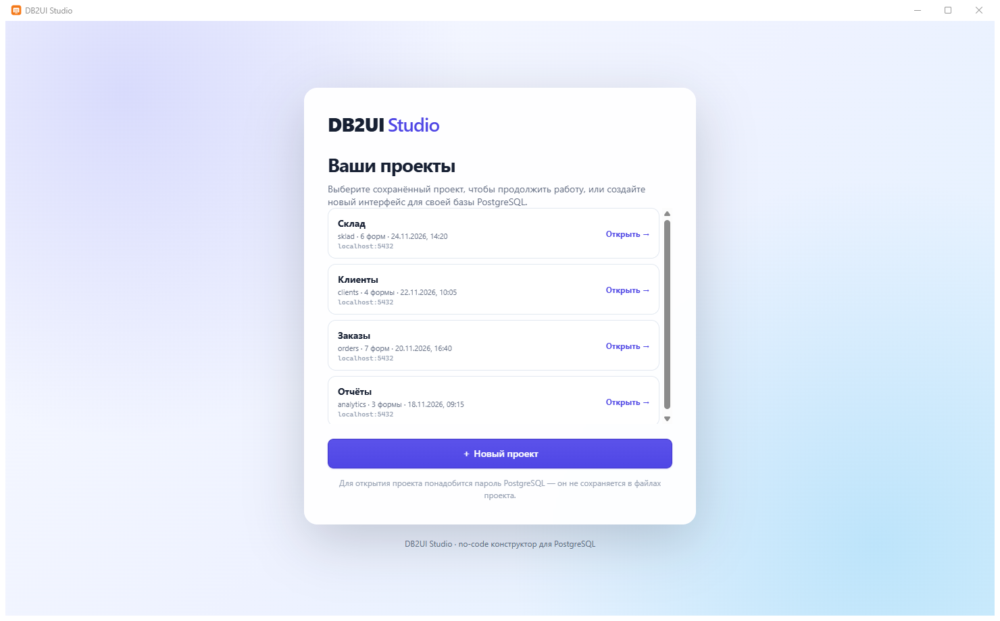

<div align="center">



# DB2UI Studio

**No-code конструктор десктопных интерфейсов для PostgreSQL**

Соберите формы, таблицы и кнопки мышью — и работайте с живыми данными
из базы. Без браузера, командной строки и программирования.

[](https://github.com/feched/DB2UI_Studio/releases/latest)
[](https://www.python.org/)
[](https://www.postgresql.org/)
[](https://flask.palletsprojects.com/)

### [⬇ Скачать установщик](https://github.com/feched/DB2UI_Studio/releases/latest)

</div>

---

## Что это

**DB2UI Studio** — приложение для Windows, в котором можно подключиться
к базе PostgreSQL и собрать собственный интерфейс: экран, панели, поля
ввода, выпадающие списки, кнопки, изображения, таблицы с данными
и SQL-запросы.

Готовый интерфейс можно сразу проверить в предпросмотре, выгрузить
в автономный HTML или скачать как отдельное приложение с локальным
сервером.

## Возможности

- **Визуальный конструктор** — перетаскивание элементов, изменение
  размеров, привязка к сетке, направляющие и выравнивание групп.
- **Несколько форм** — дерево форм, стартовая форма и переходы между
  экранами по кнопке.
- **Живые данные PostgreSQL** — таблицы, добавление, изменение и удаление
  записей прямо в предпросмотре.
- **Таблицы и связи** — ER-диаграмма, создание таблиц и колонок,
  первичные и внешние ключи.
- **Авторизация без кода** — вход и регистрация по таблице пользователей
  вашей базы, роли и переходы после входа.
- **Функции, процедуры и триггеры** — отдельная вкладка с шаблонами
  и редактором SQL.
- **Экспорт** — автономный HTML-предпросмотр или ZIP с готовым
  приложением и локальным сервером.
- **Десктопная версия** — один `DB2UI Studio.exe` и установщик
  с ярлыками; браузер не нужен.

## Установка

1. Скачайте **`DB2UI-Studio-Setup-1.1.0.exe`** со страницы
   [Releases](https://github.com/feched/DB2UI_Studio/releases/latest).
2. Запустите установщик. Права администратора не требуются:
   программа ставится в профиль пользователя.
3. Откройте **DB2UI Studio** из меню «Пуск» или с рабочего стола
   (ярлык создаётся установщиком).

**Что нужно на компьютере:**

- Windows 10 или 11 (64-бит);
- запущенный сервер PostgreSQL и доступ к нему;
- Microsoft Edge WebView2 — на Windows 10/11 обычно уже установлен.
  Если его нет, установщик покажет ссылку на бесплатный Runtime.

Проекты и настройки хранятся в `%LOCALAPPDATA%\DB2UI Studio`.
При удалении программы эта папка не удаляется.

## Первый проект

На стартовом экране показаны все сохранённые проекты: выберите нужный,
введите пароль PostgreSQL — и продолжите работу. Кнопка **«＋ Новый проект»**
создаёт новый интерфейс.

1. Запустите приложение и нажмите **«＋ Новый проект»**.
2. Укажите сервер, базу, пользователя и пароль PostgreSQL.
3. Перетащите элемент из левой палитры на холст.
4. Настройте свойства справа и добавьте ещё формы.
5. Нажмите **«Предпросмотр»**, чтобы проверить интерфейс на живых данных.

Подробное руководство: **[docs/GUIDE.md](docs/GUIDE.md)**.

## Запуск из исходников

Нужны Python 3.10+ и PostgreSQL.

```powershell
git clone https://github.com/feched/DB2UI_Studio.git
cd DB2UI_Studio
python -m venv .venv
.venv\Scripts\python.exe -m pip install -r requirements.txt
.venv\Scripts\python.exe desktop.py
```

Или просто дважды щёлкните **`run.bat`** — он создаст окружение
и откроет окно приложения. Для запуска в браузере (режим разработки)
используйте **`run-web.bat`**.

## Сборка exe и установщика

```powershell
# автономный exe
.\build-desktop.ps1 -SkipInstaller

# exe + установщик
.\build-desktop.ps1

# если Inno Setup ещё не установлен
.\build-desktop.ps1 -InstallInno
```

Результат:

- `dist\DB2UI Studio.exe` — портативный один файл;
- `dist\installer\DB2UI-Studio-Setup-<версия>.exe` — установщик.

Версия задаётся параметром `-Version`, например
`.\build-desktop.ps1 -Version 1.2.0`.

## Стек

Python · Flask · pywebview (WebView2) · psycopg2 · PostgreSQL ·
HTML / CSS / JavaScript · PyInstaller · Inno Setup

## Структура проекта

```text
DB2UI_Studio/
├── desktop.py              # запуск Flask внутри нативного окна
├── desktop.spec            # конфигурация PyInstaller
├── build-desktop.ps1       # сборка exe и установщика
├── app.py                  # Flask-сервер, API и PostgreSQL
├── standalone.py           # экспорт автономного HTML
├── portable.py             # экспорт ZIP с приложением
├── portable_runtime/       # шаблон приложения для экспорта
├── installer/              # Inno Setup и версия exe
├── assets/                 # иконка приложения
├── templates/              # интерфейс конструктора
├── static/                 # стили и логика клиента
├── docs/                   # руководство и скриншоты
├── run.bat                 # запуск из исходников
└── requirements.txt
```

## Документация

- [Полное руководство](docs/GUIDE.md) — элементы, формы, авторизация,
  таблицы, экспорт, API и настройки.
- [Где хранятся проекты](docs/SAVING_PROJECTS.md) — автозапуск, бэкап
  и перенос интерфейсов.
- [Все релизы и установщики](https://github.com/feched/DB2UI_Studio/releases)

---

<div align="center">

Сделано для быстрой сборки интерфейсов поверх PostgreSQL.

</div>
